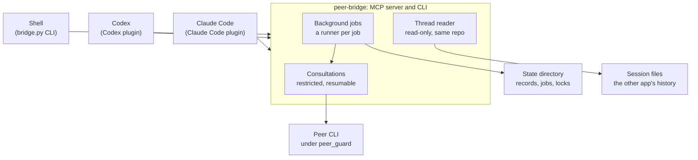
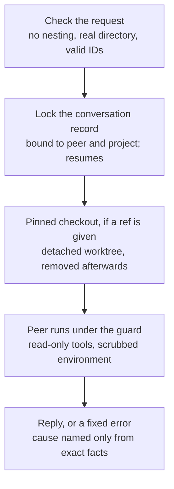
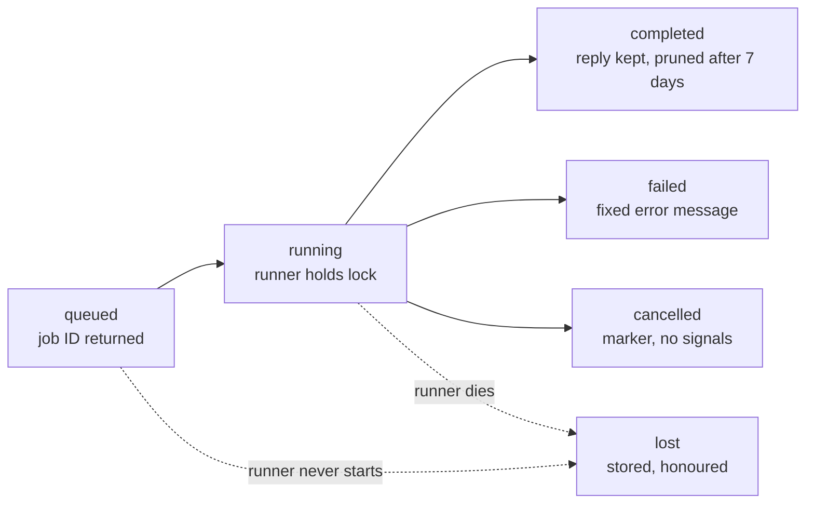

# How peer-bridge works

peer-bridge lets Claude Code consult Codex, and Codex consult Claude Code, without either one handing the other its
tools. This page describes what the bridge does today; [README.md](README.md) has setup, every argument and every
setting.

## Shape

Each app reaches the bridge through its own plugin; the shell uses the same script. The bridge does three things:

- **Consultations**: `ask_codex` and `ask_claude` ask the other agent a scoped question, in a conversation the caller
  can continue with `conversation_id`.
- **Background jobs**: `start_codex_consultation` and `start_claude_consultation` run a consultation in a detached
  runner, `get_consultation` reads it and `cancel_consultation` stops it.
- **Thread reading**: `list_codex_threads`, `read_codex_thread`, `list_claude_threads` and `read_claude_thread` read
  what the other app's agent last said in this repository.

All rules (request checks, the peer's command line, environment cleanup, the handoff text, failure diagnosis, job
states) live in two pure modules, `consultation.py` and `thread_parsing.py`; the rest only starts processes and
touches files.

## One consultation

- **The peer only reads.** Claude runs as `claude -p` with Read, Glob and Grep, only the user's own settings, no MCP
  servers or slash commands, and ordinary hooks disabled; it reads only inside the consulted directory, Claude Code's
  temporary folder, and wherever the user's own settings add a directory or allow a read. Codex runs as `codex exec` in
  its read-only sandbox, without the user's "always allow" rules, with MCP servers, plugins and web search off and only
  the core environment for its commands; it can read any file the user can. Neither can start another consultation. See
  [SECURITY.md](https://github.com/mtrzes/peer-bridge/blob/main/SECURITY.md) for what this does not cover.
- **Codex's model is chosen per call.** A Codex consultation can choose its `model` and `reasoning_effort`;
  `list_codex_models` shows what Codex offers, and a value it does not list is refused before Codex starts.
- **The peer's process group never outlives the consultation.** `peer_guard.py` leads the peer's process group and
  stops all of it when the consultation ends, times out or is cancelled, and when the bridge's own process dies, even
  by SIGKILL. Sign-in probes and git commands run under a guard too. After a failure, the sign-in probe uses the time
  left from the peer's timeout. Each guard holds the conversation's lock, so the conversation and its checkout stay
  busy until the process group has stopped. Opening a conversation gives one scope that holds its lock, its record and
  its checkout's fixed location; every process of the consultation starts through that scope, and it saves the record
  only once the peer's result has been checked against it. The sweep of leftover checkouts takes another
  conversation's lock the same way, without opening its record. The bridge's last signal to a group always comes
  before it reaps the guard, which would free the group's ID. A descendant that leaves the group, by starting its own
  session or group, is not stopped.
- **A pinned checkout is prepared within one budget.** Every git command that prepares it, from finding the
  repository to writing the files, including removing a checkout an earlier run left in its place, shares a checkout
  preparation budget of 300 seconds; a command is not started once the budget is spent. Removing the checkout
  afterwards has 120 seconds of its own and runs to its end even when the consultation is cancelled. The peer's
  timeout starts once the checkout is ready. Reading a `seed_thread`, and sweeping up checkouts that runs which died
  left behind (each with its own 120 seconds), come before both.
- **Only the reply or a fixed message comes back.** The CLI's own output never reaches the caller, and a failure is
  given a cause only when an exact signal establishes it, such as `loggedIn: false` or a writer-lock file. Codex
  events are separated by LF, so Unicode line separators inside a reply are preserved.

## Background jobs

A job lives in its own folder under the state directory. Its runner holds a lock for as long as it lives, so whether a
runner is alive is read from that lock, never from a process ID. Jobs survive an MCP server restart. A job whose runner
dies, or has yet to claim it after two minutes, is stored as `lost` when it is read, cancelled or claimed. Before that
deadline, cancellation of a queued job with no runner takes effect immediately. While a cancel waits for the runner,
`cancel_consultation` reports `cancelling`. Only a regular file counts as a cancellation marker. The job module writes
the request file and reads it back; the runner deletes it after reading it. If it cannot read the request for a valid
job, or the request lacks a field the bridge writes, it deletes the file and records `failed` with a fixed error. A
request written before `model` and `reasoning_effort` existed asks for neither. SIGTERM or SIGHUP during a CLI `start`
cancels the pending start and cleans up any job it published during creation. A start that cannot read its job once
the runner is launched, for a reason other than the job being busy, cancels the job, since the caller never learns
its ID; if that cancellation fails too, the error names the job's ID. An interrupted start ends as cancelled even when
that cleanup fails. A start that finds the runner already claiming the job reports it `queued`. The job module,
`jobs.py`, owns a start from publishing the job to returning its ID; the bridge checks the request first.

Each status read or cancellation waits at most one second for the lock on the job's state, then reports that the job
is busy. Cancelling the job of a failed or cancelled start waits as long as the lock's holder needs. The runner can
respond to `SIGTERM` or `SIGHUP` while waiting for the lock, and job cleanup skips a job whose lock is held.

Job cleanup removes only folders named with a canonical job UUID, optionally preceded by `.staging-` or `.deleting-`.

## Thread reading

The reader opens the other app's session files read-only: Claude Code's `projects/*/*.jsonl`, and Codex's rollouts,
plain or zstd-compressed. It opens regular files without following symlinks below the configured app home and
checks the recorded session ID against the filename. The listing takes Codex recency from the open rollout so
an archive move cannot interrupt the listing. The reader returns agent messages and the latest turn's state for
threads in the same git repository. `seed_thread` carries a thread's recent messages into a new consultation, so a
review left in Codex Desktop can be followed up without touching it.

The listing only picks a thread. The read opens the thread's file once and decides again, from the same bytes it
returns messages from, whether the thread is in this repository: for Codex from the rollout's `session_meta` (main
thread, working directory, not forked), for Claude Code from the latest working directory the main session records.
Claude sidechains never set that directory. Each read attempt checks the recorded directories against the repository
resolved at the start of the request. Each attempt reads the extent captured when the file was opened, including
for compressed rollouts. A file that changes while it is read is retried once, even if parsing the first attempt fails.
The Claude reader searches up to 32 MiB of recent history and refuses a session whose main working directory is
missing there. Only the current stay in the repository contributes replies and a title, including the title shown
in the listing and used for exact-name selection. A session that has just moved in shows an unfinished turn and
no messages. Claude replies follow the active branch's parent links after a rewind. If a gap between those links
cannot be resolved within the recent history window, the read is refused.

A Codex read refuses malformed turn and message fields. Message phases are the recorded `commentary` or
`final_answer` tokens, or null when the phase is absent.

The reader parses tail records one at a time and refuses windows with more than 131,072 complete lines. It uses up
to 8 MiB for the start of a Claude session, the latest part of the Codex name index, or the stored bytes needed to
find a compressed rollout header. Reading a compressed rollout allows up to 256 MiB of stored input and 2 GiB of
decoded content.

The bridge never writes into the other app's sessions. To hand work to an existing session, an agent puts the handoff
in its own reply, and that session reads it with `read_codex_thread` or `read_claude_thread`. Neither agent may reach
the other by operating its desktop app; the bridge's tool descriptions and skill say so.

To split work, the operator starts the other app in a worktree of its own (`claude --worktree` or
`codex --worktree`) with the handoff. The lead follows that session with `read_*_thread` and reviews its branch with
`ask_codex` or `ask_claude` and `ref`. No peer the bridge starts ever edits;
[ADR 0003](https://github.com/mtrzes/peer-bridge/blob/main/docs/adr/0003-peers-only-read.md) records why.

Codex's session files are an internal format. A developer tool outside the plugin, `dev/codex_app_server.py`, tests
whether Codex's app-server API could replace reading them;
[ADR 0001](https://github.com/mtrzes/peer-bridge/blob/main/docs/adr/0001-codex-thread-reader-source.md) sets when it may
take over.

## Scope

- **In:** asking the other agent a scoped question with read-only access, continuing that conversation, pinning it to
  a commit, choosing Codex's model and effort, running it in the background, and reading what the other app's agent
  last said in this repository.
- **Out:** writing to either app's sessions, operating either app's interface, letting the peer edit, write, push or use
  tools beyond reading, nesting consultations, network access of its own, and Windows.
- **Experimental:** the thread tools, `seed_thread` and `list_codex_models` read the apps' internal files, which can
  change in any release. The thread tools and `seed_thread` are off unless `PEER_BRIDGE_THREADS=1` is set.
