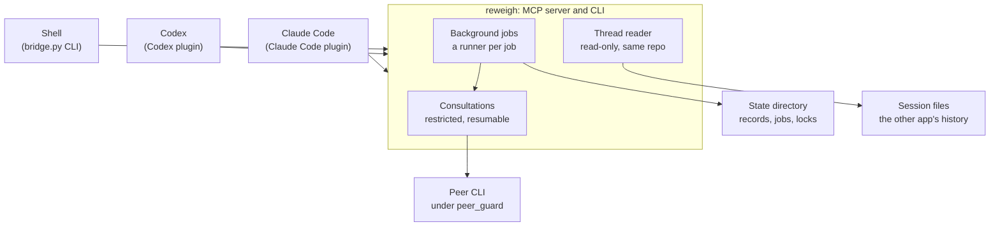
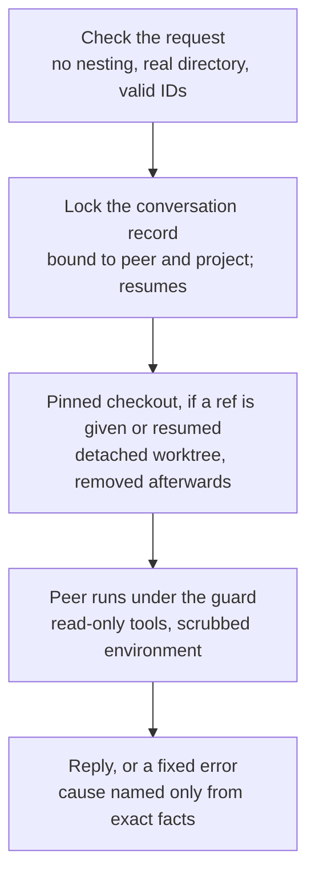
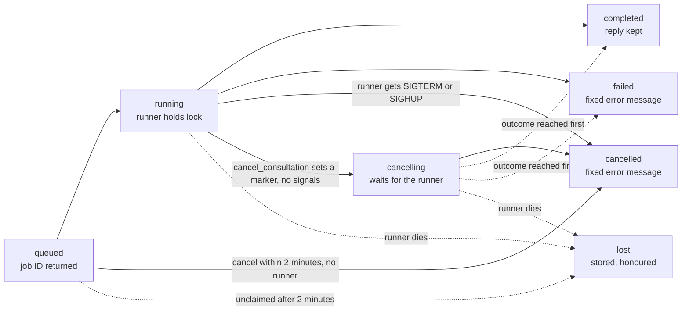

# How reweigh works

reweigh lets Claude Code consult Codex, and Codex consult Claude Code, without either one handing the other its
tools. This page describes what the bridge does today; [README.md](README.md) has setup, every argument and every
setting.

## Shape

Each app reaches the bridge through its own plugin; the shell uses the same script.

## Tools

| Tool | Does |
|---|---|
| `ask_codex` | asks Codex a scoped question, in a conversation continued with `conversation_id` |
| `ask_claude` | asks Claude Code a scoped question, in a conversation continued with `conversation_id` |
| `start_codex_consultation` | runs an `ask_codex` consultation as a background job and returns its job ID |
| `start_claude_consultation` | runs an `ask_claude` consultation as a background job and returns its job ID |
| `get_consultation` | reads a background job's state and, once completed, its reply |
| `cancel_consultation` | asks a background job's runner to stop |
| `list_codex_models` | lists the models and reasoning efforts this Codex account offers |
| `list_codex_threads` | lists Codex threads in this repository |
| `read_codex_thread` | reads a Codex thread's latest agent messages and turn state |
| `list_claude_threads` | lists Claude Code sessions in this repository |
| `read_claude_thread` | reads a Claude Code session's latest agent messages and turn state |

## Components

| Component | Owns | Code |
|---|---|---|
| Rules | request checks, the peer's command line, environment cleanup, the handoff text, failure diagnosis, job states | `scripts/consultation.py`, `scripts/thread_parsing.py` |
| Bridge | the MCP server, the CLI, consultations, probes, pinned checkouts | `scripts/bridge.py` |
| Jobs | the job store, its locks and request file, the detached runner | `scripts/jobs.py` |
| Thread reader | finding history files, the repository check made on the bytes it returns, read budgets | `scripts/thread_reader.py`, `scripts/history_capture.py` |
| Pre-launch check | whether the installed Codex still honours the names the command depends on | `scripts/preflight.py` |
| Guard | the peer's process group | `scripts/peer_guard.py` |
| State files | private files and folders under the state directory | `scripts/state_files.py`, `scripts/cleanup.py` |

The rules take every fact as an argument and touch no process, file or environment; the other components keep only
the rules bound to their own I/O. Failure diagnosis, for example, decides in the rules which facts a failed run needs;
a probe in `bridge.py` observes each one as true, false or unknown.

## One consultation

- **The peer only reads.** Claude runs as `claude -p` with the read and search tools the
  [README](README.md#runtime-boundaries) lists, and the repository's CLAUDE.md; Codex as `codex exec` in its read-only
  sandbox. Neither peer can start another consultation.
  [SECURITY.md](https://github.com/mtrzes/reweigh/blob/v1.0.0-beta.2/SECURITY.md) lists what each peer can read,
  the one known write a sub-agent can make, and what the bridge does not cover.
- **Where the two peers differ.** Claude applies the user's Claude settings and allow rules; Codex ignores the user's
  config.toml and command rules, since an allowed command runs outside its sandbox. Codex loads the repository's skills
  and can run read-only commands; Claude loads the user's own skills and the repository's CLAUDE.md, not its skills,
  and has no shell, since Claude Code's sandbox cannot keep a command from writing. Codex's plugins stay off. Where
  each reads is in
  [SECURITY.md](https://github.com/mtrzes/reweigh/blob/v1.0.0-beta.2/SECURITY.md#what-it-does-not-protect-against).
- **The model is chosen per call.** Either peer takes `model` and `reasoning_effort`. When Codex's catalogue is
  readable, a Codex model it does not list, or an effort its model does not list, is refused before Codex starts; the
  [README](README.md#consultation-requests) says when the choice goes unchecked.
- **A lost restriction refuses the call before the peer starts.** `preflight.py` runs Codex in an empty home with only
  `PATH` and `HOME`, under the consultation's guard and within its timeout. Each disabled feature must be listed and
  off; each restricting `-c` key must refuse a wrong-type value, as Codex does for a key it knows; and Codex must
  accept the command's top-level options. A lost name refuses the call. A check that cannot tell adds `warnings` to a
  successful result. The command is never changed. The `exec` options are not checked: Codex refuses one it does not
  know, so the consultation fails. Claude Code is checked only by the contract tests.
- **The peer's process group never outlives the consultation.** `peer_guard.py` leads the group and stops all of it
  when the consultation ends, times out or is cancelled, and when the bridge dies, even by SIGKILL; sign-in probes and
  git commands run under a guard too. Each guard holds the conversation's lock until its group has stopped. The git
  command that checks a `seed_thread`'s repository runs before the conversation opens, unguarded. A descendant that
  starts its own session or group is not stopped.
- **A pinned checkout is prepared within one budget.** The git commands that prepare it, including removing a checkout
  an earlier run left in its place, share 300 seconds. Removing it afterwards has 120 seconds; a checkout it cannot
  remove is left for a later sweep, and the consultation's outcome stands. The peer's timeout starts once the checkout
  is ready. Reading a `seed_thread`, and sweeping checkouts left by runs that died (120 seconds each), come first.
- **Only the reply or a fixed message comes back.** The CLI's own output never reaches the caller, and a failure is
  given a cause only when an exact fact establishes it, such as `loggedIn: false` or a writer-lock file. Codex events
  are separated by LF, so Unicode line separators inside a reply are preserved.

## Background jobs

| State | Meaning |
|---|---|
| `queued` | the job is published and its ID returned; no runner has claimed it |
| `running` | a runner has claimed the job and holds its lock |
| `cancelling` | a cancellation marker is set; the runner has yet to stop |
| `completed` | the consultation finished and its reply is kept |
| `failed` | the consultation or its request failed, with a fixed error message |
| `cancelled` | the job stopped before an outcome, by a cancellation or a signal to its runner |
| `lost` | the runner died, or never claimed the job within two minutes |

A job lives in its own folder under the state directory and survives an MCP server restart. Whether a runner is alive
is read from the lock it holds, never from a process ID. A job is stored as `lost` when a read, a cancellation or a
claim finds its runner gone; a stored outcome, `lost` included, is final. Cancelling settles a job no runner has
claimed, marks a running one, and leaves an existing outcome as it is. The runner deletes the request once read; a
request it cannot read is deleted and the job `failed`. A start whose first status read finds the lock busy reports
the job `queued`. A CLI `start` that is interrupted, or cannot read its job once the runner is launched, tries to
cancel the job, since the caller never learns its ID; if that fails, the error names the ID. A status read or
cancellation waits at most one second for the job's state lock, then reports the job busy; the runner still answers
SIGTERM and SIGHUP while it waits, and cleanup skips a job whose lock is held. The locking model is in
`scripts/jobs.py`; how long a finished job is kept, in
[SECURITY.md](https://github.com/mtrzes/reweigh/blob/v1.0.0-beta.2/SECURITY.md#what-is-kept-and-for-how-long).

## Thread reading

The reader opens the other app's session files read-only: Claude Code's `projects/*/*.jsonl`, and Codex's rollouts,
plain or zstd-compressed. It opens regular files without following symlinks below the configured app home and checks
the recorded session ID against the filename. One lookup per app finds the history files for listing, reading and
failure diagnosis; it counts each history folder it cannot list instead of taking it as empty, and diagnosis never
says a history is gone while a folder could not be listed. `seed_thread` carries a thread's recent messages into a new
consultation, so a review left in Codex Desktop can be followed up without touching it.

The listing only picks a thread. Each read attempt opens the thread's file once and decides again, from the same bytes
it returns messages from, whether the thread is in this repository: for Codex from the rollout's `session_meta` (main
thread, working directory, not forked), for Claude Code from the latest working directory the main session records.
A file that changes while it is read is retried once. Only a Claude session's current stay in the repository
contributes replies and a title, following the active branch after a rewind; a session that has just moved in shows an
unfinished turn and no messages. A session whose branch links are malformed is listed without a title and its read is
refused; a gap that cannot be resolved within the recent history leaves no title and refuses a read that needs the
records beyond it. A Codex read refuses malformed turn and message fields, and a Claude read refuses prompt text or a
stop reason of the wrong type; any other failure inside the reader is a reader fault, not a damaged file. Message
phases are the recorded `commentary` or `final_answer` tokens, or null. The reader refuses windows of more than
131,072 complete lines, uses up to 8 MiB for a Claude session's start, the Codex name index or a compressed rollout's
header, and allows a compressed rollout 256 MiB stored and 2 GiB decoded.

The bridge never writes into the other app's sessions. An agent never reaches the other app by operating its desktop
app; it puts a handoff in its own reply, which the other session reads with `read_codex_thread` or
`read_claude_thread`. To split work, the operator
starts the other app in its own worktree (`claude --worktree`, `codex --worktree`), and the lead follows it with
`read_*_thread` and reviews its branch with `ref`. No peer ever edits;
[ADR 0003](https://github.com/mtrzes/reweigh/blob/v1.0.0-beta.2/docs/adr/0003-peers-only-read.md) records why.

Codex's session files are an internal format. A developer tool outside the plugin, `dev/codex_app_server.py`, tests
whether Codex's app-server API could replace reading them;
[ADR 0001](https://github.com/mtrzes/reweigh/blob/v1.0.0-beta.2/docs/adr/0001-codex-thread-reader-source.md) sets
when it may take over.

## Scope

- **In:** asking the other agent a scoped question with read-only access (SECURITY.md names one exception),
  continuing that conversation, pinning it to a commit, choosing either peer's model and effort, running it in the
  background, and reading what the other app's agent last said in this repository.
- **Out:** writing to either app's sessions, operating either app's interface, letting the peer edit, write or push,
  tools beyond reading, search and, unless switched off, sub-agents, nesting consultations, other network access of its
  own, and Windows.
- **Experimental:** the thread tools, `seed_thread` and `list_codex_models` read the apps' internal files, which can
  change in any release. The thread tools and `seed_thread` are off unless `REWEIGH_THREADS=1` is set.
